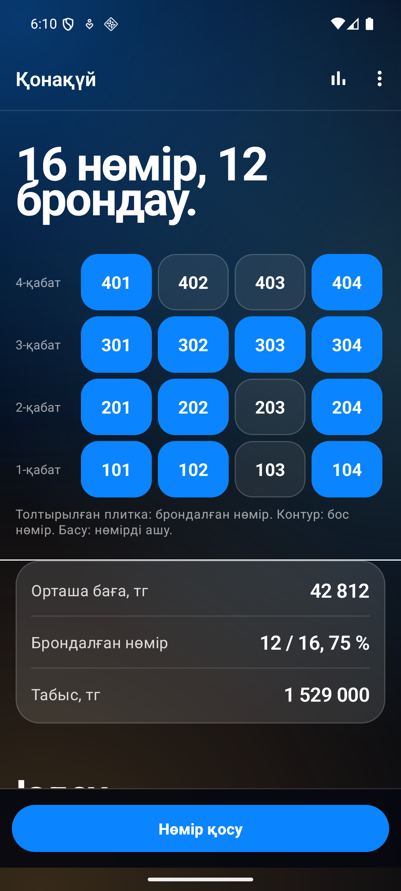
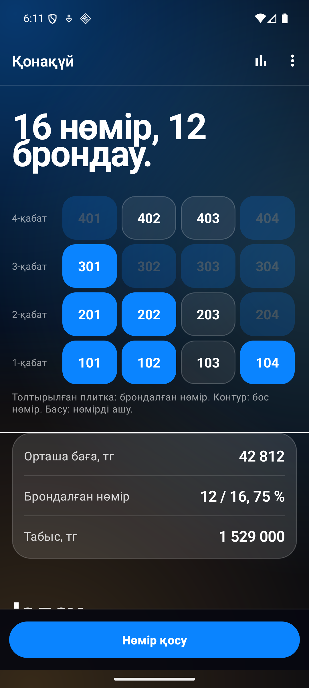
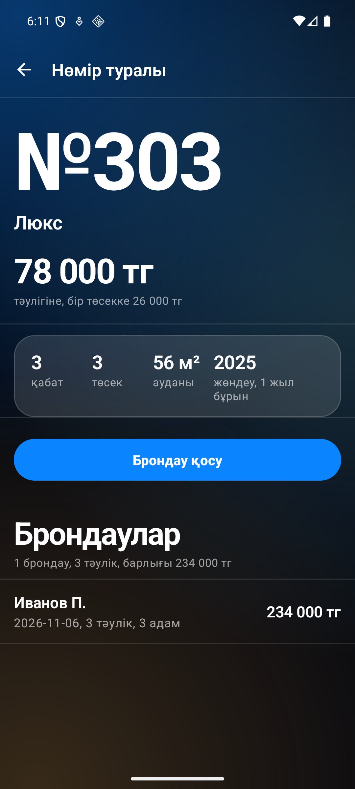
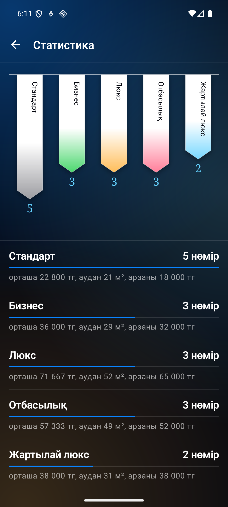
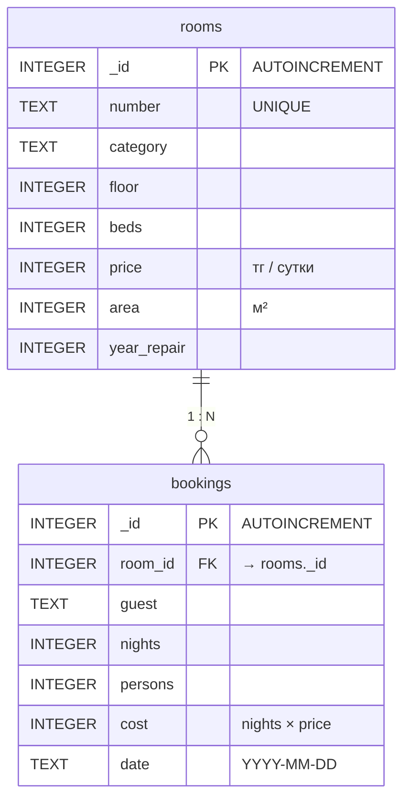

<div align="center">

# 🏨 Қонақүй — Hotel Manager

**Android-приложение для учёта гостиничных номеров и бронирований на SQLite**

[](https://developer.android.com)
[](https://docs.oracle.com/javase/)
[](https://www.sqlite.org)
[](https://developer.android.com)
[](https://gradle.org)

Групповая работа · ЕНУ им. Л.Н. Гумилёва · группа **ЖИТ-31**
Дисциплина «Мобильді құрылғыларды программалау»

</div>

---

## О проекте

В маленьких гостиницах учёт номеров до сих пор ведут в бумажном журнале: найти нужный номер — минуты, посчитать среднюю цену или выручку — невозможно, а опечатку никто не проверяет.

**Қонақүй** переносит этот журнал в локальную базу SQLite прямо на устройстве: поиск выполняется мгновенно, стоимость брони считается автоматически, а статистика собирается агрегатными запросами. Приложение работает полностью офлайн — ни сервера, ни интернета не требуется.

<div align="center">

| Главный экран и шахматка | Поиск и результат | Номер и брони | Статистика |
|:---:|:---:|:---:|:---:|
|  |  |  |  |

</div>

---

## Возможности

| | Функция | Что под капотом |
|:---:|---|---|
| 🔐 | **Вход и роли** admin и client: логин и пароль проверяются по таблице `users`, пароль хранится как SHA-256, сессия в `SharedPreferences` | `SELECT ... WHERE username = ? AND pass = ?` |
| 🏨 | **Шахматка отеля**: этажи и номера плитками, занятые подсвечены, нажатие открывает номер, плитки вне результата поиска гаснут | `SELECT DISTINCT room_id FROM bookings` |
| 🔍 | **Три режима поиска** — по категории, по этажу + максимальной цене, «дешевле средней цены»; на экране виден реальный SQL-запрос | `query()` с параметризованным `WHERE`, подзапрос `AVG(price)` |
| ↕️ | **Четыре варианта сортировки** списка | динамический `ORDER BY` |
| ➕ | **Добавление номера** с семью проверками ввода | `INSERT` через `ContentValues`, `UNIQUE` на номере |
| ✏️ | **Изменение цены и числа мест** | `UPDATE ... WHERE _id = ?` |
| 🗑️ | **Удаление номера** вместе с его бронями, групповое удаление по году ремонта | каскад `DELETE` в правильном порядке |
| 🛏️ | **Бронирование** с живым расчётом стоимости: DatePicker, TimePicker, SeekBar, CheckBox, ToggleButton, RadioButton | `cost = nights × price` |
| 🧊 | **3D-шахматка**: здание из кубов, вращается и крутится пальцем | OpenGL ES 2.0 |
| 📁 | **Отчёт в файл** `hotel_report.csv` и чтение из приложения | `FileOutputStream`, `BufferedReader` |
| 📊 | **Экран статистики** — загрузка, средняя/мин/макс цена, срез по категориям, выручка по номерам | `COUNT / AVG / MIN / MAX / SUM`, `GROUP BY … HAVING`, `LEFT JOIN` |
| 🪵 | **Отладка через LogCat** — свой TAG в каждом классе | `Log.i / Log.w / Log.e` |

---

## Вход и роли

При первом запуске открывается экран входа. Демо-аккаунты:

| Логин | Пароль | Роль | Что доступно |
|---|---|---|---|
| `admin` | `admin123` | админ | всё: номера, брони, статистика, файл, сброс базы |
| `client` | `client123` | клиент | просмотр и поиск номеров, свои брони (смотреть и отменять), 3D |

Новый клиент создаётся кнопкой «Тіркелу». Рабочие данные и роли живут в базе, поэтому после обновления с версии 1 база мигрирует без потери данных (`onUpgrade`: добавляются колонки и таблица `users`).

---

## Соответствие силабусу МКР 3311

| Неделя | Тема | Где в проекте |
|:---:|---|---|
| 1 | Структура Android, эмулятор | проект Android Studio, проверка на AVD |
| 2 | Архитектура приложения | три слоя: модели, `DbHelper`, интерфейс |
| 3 | Жизненный цикл Activity, TextView, EditText, Button | `onCreate/onStart/onPause/onStop/onDestroy` пишутся в LogCat |
| 4 | Toast, CheckBox, ToggleButton, RadioButton, DatePicker, TimePicker, SeekBar | диалог брони (`RoomActivity`) |
| 5 | Адаптеры и списки | `RoomAdapter`, `BookingAdapter`, три `ListView` |
| 6 | Меню и подменю | `main_menu.xml`, подменю «Деректер», меню зависит от роли |
| 7 | Manifest, Intent, передача данных, сериализация | `Room`, `Booking`, `User` реализуют `Serializable`; `Room` передаётся через `Intent` |
| 8 | Диалоги | `AlertDialog`, `DatePickerDialog`, `TimePickerDialog` |
| 9 | Фрагменты и их жизненный цикл | статистика: `StatsOverviewFragment`, `StatsCategoriesFragment`, `StatsRevenueFragment` |
| 10 | SQLite: подключение, сохранение | `rooms`, `bookings`, `users` |
| 11 | update, delete, query, фильтр, сортировка, группировка | `DbHelper`, `GROUP BY`, `JOIN`, подзапрос |
| 12 | Мультимедиа и анимация | `ObjectAnimator`, `ValueAnimator`, анимация списка, звук `ToneGenerator`, видео 15 с в `VideoActivity` (`VideoView`, `res/raw/hotel_intro.mp4`) |
| 13 | Работа с файлами | `hotel_report.csv`, `SharedPreferences` |
| 14 | 2D-графика | `StripChartView` на `Canvas` |
| 15 | 3D-графика | `Hotel3DActivity`, `Hotel3DRenderer` (OpenGL ES 2.0) |

Из тем самостоятельной работы силабуса (БӨЖ: сервисы, `BroadcastReceiver`, `ContentProvider`) в приложении ничего не реализовано, как и видео из недели 12.

---

## Схема базы данных

База `hotel.db` (версия 2) состоит из трёх таблиц: `rooms`, `bookings` (связаны как «один ко многим») и `users`. Ниже схема основных двух.



При старте база заполняется демо-данными: **16 номеров** пяти категорий и **12 броней**.

---

## Ключевые запросы

Три метода `DbHelper` закрывают три пункта задания:

```java
// а) все номера заданной категории
return readRooms(R_CATEGORY + " = ?", new String[]{category});

// ә) номера на этаже не дороже заданной цены
return readRooms(R_FLOOR + " = ? AND " + R_PRICE + " <= ?",
        new String[]{String.valueOf(floor), String.valueOf(maxPrice)});

// б) номера дешевле средней цены по гостинице
int avg = averagePrice();            // SELECT AVG(price) FROM rooms
return readRooms(R_PRICE + " < ?", new String[]{String.valueOf(avg)});
```

Статистика собирается двумя «тяжёлыми» запросами:

```sql
-- срез по категориям
SELECT category, COUNT(*), AVG(price), AVG(area), MIN(price)
FROM rooms GROUP BY category HAVING COUNT(*) > 0
ORDER BY COUNT(*) DESC, category ASC;

-- выручка по каждому номеру, включая номера без броней
SELECT r.number, r.category, COUNT(b._id), SUM(b.nights), SUM(b.cost)
FROM rooms r LEFT JOIN bookings b ON b.room_id = r._id
GROUP BY r._id ORDER BY SUM(b.cost) DESC;
```

---

## Структура проекта

```
Hotel/app/src/main/
├── java/com/example/hotel/
│   ├── Room, Booking, User       модели (Serializable)
│   ├── DbHelper.java             SQLite: 3 таблицы, все запросы, миграция v1 в v2
│   ├── Session.java              сессия на SharedPreferences
│   ├── LoginActivity.java        вход, регистрация, роли
│   ├── MainActivity.java         шахматка, поиск, сортировка, меню по роли
│   ├── RoomActivity.java         номер, брони, диалог брони
│   ├── AddRoomActivity.java      добавление номера + валидация
│   ├── MyBookingsActivity.java   брони клиента
│   ├── StatsActivity.java        вкладки статистики
│   ├── Stats*Fragment.java       3 фрагмента статистики
│   ├── VideoActivity.java        видео (VideoView)
│   ├── Hotel3DActivity.java      3D-шахматка (OpenGL ES 2.0)
│   ├── Hotel3DRenderer.java      шейдеры и куб
│   ├── RoomAdapter, BookingAdapter   адаптеры ListView
│   └── StripChartView, StatsViews, Ui  2D-диаграмма, общие помощники
└── res/layout/                   20 макетов на виджетах Material 3
```

Архитектура — три слоя: модели, слой данных (`DbHelper`) и UI. Ни один `Activity` не пишет SQL — все обращения идут через методы `DbHelper`.

---

## Сборка и запуск

```bash
git clone https://github.com/ab0ka/hotel-android-sqlite.git
cd hotel-android-sqlite/Hotel
./gradlew assembleDebug
```

APK окажется в `Hotel/app/build/outputs/apk/debug/`. Готовый собранный файл также лежит в корне репозитория — [`Қонақүй.apk`](Қонақүй.apk).

Открыть в Android Studio: `File → Open → папка Hotel`.

| Параметр | Значение |
|---|---|
| minSdk / targetSdk | 24 / 37 |
| Язык | Java 11 |
| Зависимости | AppCompat, Material 3, Activity, ConstraintLayout |
| Дизайн | тёмный градиент, стеклянные скруглённые панели, крупные заголовки, один акцентный синий; шрифты системные |
| Внешние библиотеки для БД | нет — только `android.database.sqlite` |

---

## Тестирование

Все функции прогнаны на эмуляторе (Pixel, API 34). Результаты совпали с ожидаемыми:

| Проверка | Ожидалось | Факт |
|---|---|:---:|
| а) категория «Люкс» | 3 номера | ✅ |
| ә) 2 этаж, ≤ 40 000 ₸ | 3 номера | ✅ |
| б) дешевле средней (42 812 ₸) | 10 номеров | ✅ |
| Бронь на 3 суток × 78 000 ₸ | 234 000 ₸ | ✅ |
| Дубль номера «405» | запись отклонена | ✅ |
| Гостей больше, чем мест | бронь отклонена | ✅ |
| Удаление номеров с ремонтом до 2020 | 16 → 13 номеров | ✅ |
| Сброс к исходным данным | 16 номеров, 12 броней | ✅ |

Полный протокол из 12 сценариев и выдержки из LogCat — в отчёте.

---

## Состав репозитория

| Файл | Описание |
|---|---|
| [`Hotel/`](Hotel) | исходный код Android-проекта |
| [`скрины/`](скрины) | скриншоты: `01–25` прежней версии интерфейса и `new_*` нового дизайна |
| [`Қонақүй.apk`](Қонақүй.apk) | собранный APK (debug) |
| [`Топтық_жұмыс_Қонақүй_ЖИТ-31.docx`](Топтық_жұмыс_Қонақүй_ЖИТ-31.docx) | отчёт: листинги, разбор кода, тесты, 32 контрольных вопроса |
| [`Қонақүй_презентация.html`](Қонақүй_презентация.html) | презентация для защиты: один HTML-файл с анимациями, листается стрелками и пробелом |

---

## Команда

<div align="center">

| | Участник | Зона ответственности |
|:---:|---|---|
| 🗄️ | **Сәбит Абзал** | Проектирование таблиц, класс `DbHelper`, все SQL-запросы, `GROUP BY` и `JOIN`, архитектура |
| 🎨 | **Сатар Ақтоты** | Интерфейс: 10 макетов, Toolbar и меню, адаптеры `ListView`, диалоги, экран статистики |
| 🧪 | **Саяхмет Жайық** | Логика бронирования и расчётов, валидация ввода, LogCat, тестирование, материалы отчёта |

</div>

---

<div align="center">

**ЖИТ-31 · 2026** · Назарларыңызға рақмет! 🎓

</div>
